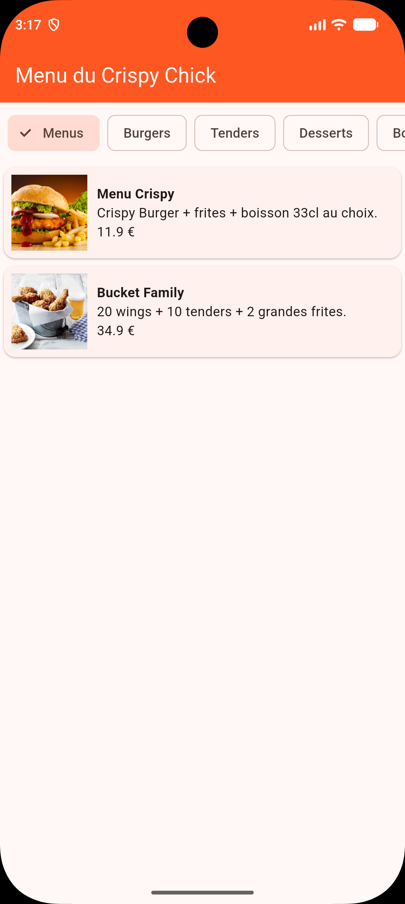
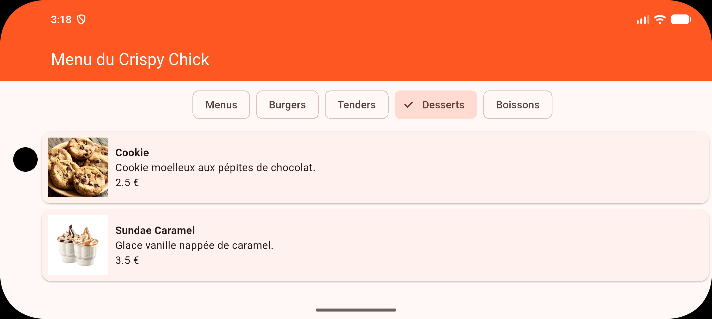

# Crispy Chick - Menu de restaurant (Flutter)

DS Flutter Layouts & Scrolls : application mobile affichant le menu d'un snack de poulet.

## Fonctionnalités
- Catégories défilables horizontalement (Menus, Burgers, Tenders, Desserts, Boissons)
- Sélection d'une catégorie pour afficher ses plats
- Chaque plat est affiché dans une carte : image, nom, description et prix
- Fonctionne en mode portrait et paysage

## Organisation du code
- `lib/main.dart` : écran principal (AppBar, barre de catégories, liste des plats)
- `lib/models/plat.dart` : classe `Plat`
- `lib/data/menu_data.dart` : catégories et plats codés en dur
- `lib/widgets/plat_card.dart` : widget réutilisable pour afficher un plat

## Captures

## Vidéo
[Voir la démo](screenshots/demo.webm)

## Lancer le projet
flutter pub get
flutter run

Auteur : Kaan Topkaya